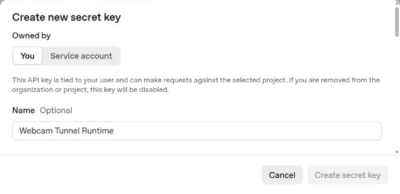
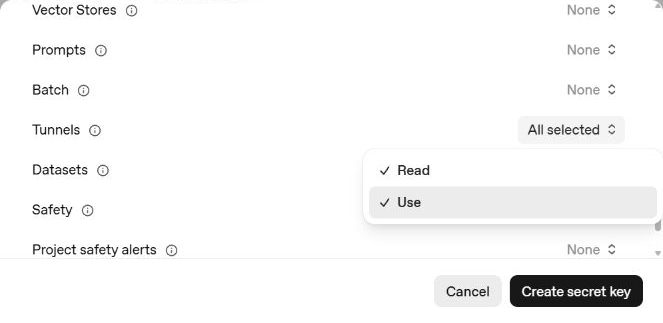
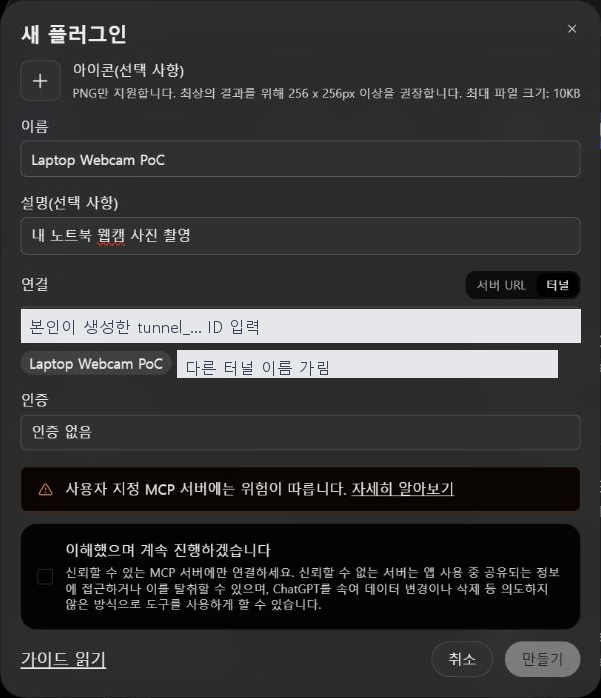

# 라즈베리파이 카메라 MCP 설치 및 사용 매뉴얼

문서 버전 1.1 · 2026년 9월 29일 · Raspberry Pi OS 64비트용

Git으로 내려받는 경우 라즈베리파이에서 다음 명령을 사용합니다. 이후 아래 매뉴얼의 ZIP 압축 해제 단계는 생략합니다.

```bash
git clone https://github.com/minato675/ssafy207.git
cd ssafy207
bash setup.sh usb
bash connect-chatgpt.sh usb
```

[PDF 매뉴얼](docs/라즈베리파이_웹캠_MCP_매뉴얼.pdf) · [수정용 Word](docs/라즈베리파이_웹캠_MCP_매뉴얼.docx)

사용자 지정 구성은 Raspberry Pi 4/5 + USB 웹캠입니다. 기본 설치는 bash setup.sh usb, GPT 연결은 bash connect-chatgpt.sh usb를 사용합니다. CSI 절차는 카메라 모듈로 변경할 때만 참고합니다.

라즈베리파이에 연결한 USB 웹캠 또는 CSI 카메라로 사진 한 장을 촬영하고 ChatGPT에서 분석하는 로컬 MCP입니다. 프로그램을 별도 클라우드 서버에 배포하지 않습니다. 라즈베리파이의 터널 프로그램이 OpenAI로 연결하므로 인터넷이 필요하며, 요청한 사진은 ChatGPT로 전송됩니다.

## 1 동작 구조와 지원 범위

핸드폰 또는 PC의 ChatGPT → OpenAI Secure MCP Tunnel → 라즈베리파이의 MCP → 라즈베리파이에 연결된 카메라 순서로 촬영합니다. 사진은 같은 연결을 통해 ChatGPT로 반환됩니다. 라즈베리파이로 옮기면 노트북 카메라가 아니라 라즈베리파이 카메라가 촬영됩니다.

- 권장 대상: Raspberry Pi 4 또는 5, Raspberry Pi OS 64비트 Bookworm 이후, Python 3.11 이상.
- 아키텍처: aarch64 및 64비트 사용자 공간. 32비트 armv7l OS는 이 패키지의 대상이 아닙니다.
- USB 웹캠: OpenCV의 Linux V4L2로 /dev/videoN을 열어 촬영합니다.
- CSI 카메라 모듈: Raspberry Pi OS의 rpicam-still로 촬영합니다. 구형 raspistill은 사용하지 않습니다.
- 서버: 127.0.0.1:8765/mcp, Streamable HTTP. 공유기 포트포워딩은 필요하지 않습니다.
- 상태: 127.0.0.1:18765/readyz. 라즈베리파이 자신에게 접속하는 주소입니다.
- GUI 없이 SSH 터미널에서도 실행할 수 있습니다. 수동 실행은 터미널을 유지하며, 8장의 자동 시작 서비스를 설치하면 로그인이나 SSH 연결 없이 실행됩니다.

이 패키지는 Windows 개발 PC에서 코드·오류 처리·MCP 통신을 검증했습니다. 실제 라즈베리파이 장치의 설치, 카메라 촬영, ARM64 터널 실행은 현장 검증이 필요합니다. 기존 Windows MCP는 사용자가 모바일 ChatGPT에서 호출하여 작동했음을 확인했습니다. 이 결과가 라즈베리파이 하드웨어 검증을 대신하지는 않습니다.

## 2 파일을 라즈베리파이로 옮기기

webcam-mcp-raspberrypi-v1.1.zip을 라즈베리파이 홈 폴더에 복사합니다. USB 메모리 또는 SCP를 사용할 수 있습니다. 아래 SCP 예시에서 계정과 주소는 자신의 환경으로 바꿉니다.

```powershell
scp .\webcam-mcp-raspberrypi-v1.1.zip 사용자명@라즈베리파이주소:~/
```

라즈베리파이의 터미널 또는 SSH에서 실행합니다.

```bash
sudo apt-get update
sudo apt-get install -y unzip
unzip webcam-mcp-raspberrypi-v1.1.zip
cd webcam-mcp-raspberrypi
uname -m
getconf LONG_BIT
```

각각 aarch64와 64가 출력되어야 합니다. 아래 모든 명령은 압축 해제된 webcam-mcp-raspberrypi 폴더에서 실행합니다. 파일 실행 권한이 보존되지 않아도 bash로 실행할 수 있습니다.

## 3 카메라 종류에 맞게 설치

USB 웹캠은 USB 포트에 연결합니다. CSI 모듈은 라즈베리파이 전원을 끈 상태에서 해당 모델에 맞는 케이블로 연결한 뒤 전원을 켭니다. Pi 5 등은 카메라 커넥터 규격이 다를 수 있습니다.

USB 웹캠을 사용할 때:

```bash
bash setup.sh usb
v4l2-ctl --list-devices
```

CSI 카메라 모듈을 사용할 때:

```bash
bash setup.sh csi
rpicam-still --list-cameras
```

설치기는 apt로 Python, OpenCV, Pillow, v4l-utils를 설치하고, CSI 모드에서는 rpicam-apps도 설치합니다. OS에서 제공하는 카메라 라이브러리를 이용하기 위해 가상환경은 --system-site-packages 옵션으로 만듭니다. mcp 1.30.0은 가상환경에 설치합니다. 전체 스크립트를 sudo로 실행하지 마세요. apt가 필요할 때만 sudo 암호를 요청합니다.

동봉한 OpenAI tunnel-client v0.0.15 Linux ARM64 ZIP을 고정 SHA256으로 검증한 다음 압축을 풉니다. Windows용 exe는 포함하지 않습니다. OpenCV와 카메라 드라이버 버전은 사용 중인 Raspberry Pi OS의 apt 저장소에 따릅니다.

권한 오류가 나면 장치와 그룹을 확인합니다.

```bash
ls -l /dev/video*
id -nG
sudo usermod -aG video "$USER"
```

video 그룹을 추가했다면 로그아웃 후 재로그인합니다. 서버를 root로 실행하거나 장치 권한을 모두에게 개방하지 않습니다.

## 4 로컬 촬영 먼저 확인

터미널 A에서 USB 또는 CSI 중 하나를 실행합니다.

```bash
bash run-local.sh usb
# CSI라면 대신: bash run-local.sh csi
```

터미널 B에서 상태 검사와 실제 촬영 검사를 차례로 실행합니다.

```bash
.venv/bin/python check.py
.venv/bin/python check.py --capture
```

첫 명령은 카메라를 켜지 않습니다. 두 번째 명령만 한 장을 촬영하며 JPEG를 디코딩하여 크기와 바이트 수를 출력합니다. 사진을 파일로 저장하지 않습니다. PASS와 capture: passed를 확인합니다.

USB 장치가 /dev/video2라면 인덱스를 지정합니다. 한 웹캠에 여러 video 장치가 생길 수 있으므로 v4l2-ctl 목록에서 영상 입력 장치를 확인합니다.

```bash
.venv/bin/python check.py --capture --index 2
```

검사 후 터미널 A에서 Ctrl+C로 로컬 MCP를 종료합니다. 다음 단계의 연결 실행기가 MCP를 새로 시작하므로 8765 포트가 비어 있어야 합니다.

## 5 OpenAI 터널과 API 키 준비

본인 계정으로 다음 주소에 접속합니다.

https://platform.openai.com/settings/organization/tunnels

Create tunnel을 선택하고 이름을 Raspberry Pi Camera로 지정합니다. 설명에는 요청 시 라즈베리파이 카메라 사진 한 장을 반환한다고 적습니다. 본인 Platform 조직과 사용할 ChatGPT 워크스페이스를 연결한 뒤 생성된 tunnel_… ID를 보관합니다. 생성에는 조직의 Tunnels Read + Manage 권한이 필요합니다.

기존 노트북 터널을 그대로 사용할 수도 있지만 노트북의 터널을 반드시 먼저 종료해야 합니다. 동일 터널에 노트북과 라즈베리파이를 동시에 연결하면 요청을 처리하는 장치가 불명확해질 수 있습니다. 두 기기를 함께 쓸 때는 Raspberry Pi Camera라는 별도 터널과 별도 ChatGPT 앱을 생성하세요.

API 키는 다음 주소에서 생성합니다.

https://platform.openai.com/settings/organization/api-keys

1. Create new secret key를 누릅니다. Admin keys에서 발급하지 않습니다.
2. Owned by는 개인 테스트 기준 You를 선택하고, 이름은 Raspberry Pi Camera Runtime으로 입력합니다.
3. 터널에 접근 가능한 본인 조직의 프로젝트와 테스트 기간에 맞는 만료일을 선택합니다.
4. Permissions에서 Restricted를 선택합니다.
5. Tunnels 항목에서 Read와 Use를 모두 선택합니다. 이 행의 All selected는 전체 API 권한 All과 다릅니다.
6. Create secret key를 누르고 발급된 값을 개인 비밀정보 저장소에 보관합니다. 문서나 채팅에 붙여넣지 않습니다.

ChatGPT 개발자 기능 접근 권한, 조직 터널 권한, API 키 권한은 별개입니다. 키만 발급한다고 사용할 수 없는 ChatGPT 기능이 활성화되지는 않습니다.



화면 1. 기존 매뉴얼에서 캡처한 API 키 생성 양식입니다. 이번 설치에서는 이름을 Raspberry Pi Camera Runtime으로 입력합니다.



화면 2. Tunnels의 Read와 Use 선택 화면입니다. 캡처에는 실제 비밀 키가 포함되어 있지 않습니다.

## 6 라즈베리파이에서 GPT 연결 실행

USB 또는 CSI에 맞는 명령을 실행합니다.

```bash
bash connect-chatgpt.sh usb
# CSI라면 대신: bash connect-chatgpt.sh csi
```

1. Your OpenAI tunnel ID에 자신의 tunnel_… ID를 입력합니다.
2. 로컬 MCP가 시작되고 상태 검사가 실행됩니다.
3. Runtime API key에 자신의 키를 입력하고 Enter를 누릅니다. 키는 숨겨집니다.
4. doctor가 통과하면 터널이 실행됩니다. 이 창을 열어 둡니다.

다른 라즈베리파이 터미널에서 상태를 확인합니다.

```bash
curl http://127.0.0.1:18765/readyz
```

ready 응답이 정상입니다. Tunnel started 문구만으로 원격 연결 성공을 단정하지 말고 readyz와 ChatGPT 도구 호출까지 확인합니다. 수동 실행은 입력한 키를 파일이나 명령행 인수에 저장하지 않습니다. 카메라 MCP와 촬영 작업에는 키를 전달하지 않습니다.

실행 중 생성되는 profiles/터널ID/webcam.yaml에는 터널 설정이 들어갑니다. 수동 실행은 키를 매번 입력합니다. 입력 없이 부팅 시 연결하려면 8장의 서비스를 설치합니다.

## 7 ChatGPT 앱 등록과 모바일 사용

PC 브라우저에서 https://chatgpt.com/plugins 에 접속합니다. 필요하면 계정 설정에서 개발자 모드를 켭니다. 현재 메뉴 기준 플러그인 → 추가 → MCP 앱 만들기로 이동합니다.

- 이름: Raspberry Pi Camera
- 설명: 내 라즈베리파이에 연결된 카메라에서 사진 한 장 촬영
- 연결: 터널
- 터널 ID: 위에서 생성한 본인 ID
- 인증: 인증 없음

안내를 확인한 뒤 만들기와 연결하기를 완료합니다. 인증 없음은 라즈베리파이 내부 MCP에 OAuth가 없다는 뜻이며 OpenAI 터널 계정 권한은 계속 적용됩니다. 도구 목록에 camera_status와 capture_photo가 있는지 확인합니다.



화면 3. 기존 노트북 매뉴얼의 등록 예시입니다. 이름과 설명을 Raspberry Pi Camera용으로 바꾸고 반드시 자신의 터널을 선택합니다.

ChatGPT 대화에서 Raspberry Pi Camera 앱을 선택한 뒤 먼저 상태를 요청합니다.

```text
camera_status로 연결 상태를 확인해줘. 사진은 촬영하지 마.
```

ready=true와 backend가 usb 또는 csi인지 확인합니다. camera_tested=false는 상태 도구가 카메라를 켜지 않았다는 뜻입니다.

```text
capture_photo로 라즈베리파이 카메라 사진 한 장 찍고 무엇이 보이는지 설명해줘.
```

승인 안내가 나오면 요청을 확인합니다. USB 인덱스가 2라면 camera_index=2로 촬영해 달라고 명시합니다. 기본 요청 크기는 1280×720이고 하드웨어에 따라 작아질 수 있습니다. 일반적인 카메라 범위 내에서 요청 폭과 높이를 지정할 수 있습니다.

모바일에서는 동일한 ChatGPT 계정과 워크스페이스에서 해당 앱을 선택하여 요청합니다. 기존 Windows 구성의 모바일 호출 성공은 사용자 확인 사항이며, 이 라즈베리파이 배포본도 실제 기기에서 별도로 촬영 결과를 확인해야 합니다. 핸드폰과 라즈베리파이는 같은 와이파이일 필요가 없지만 각각 인터넷에 연결되어야 합니다.

## 8 전원을 켜면 자동 연결하기

처음 한 번 터널과 ChatGPT 앱을 등록하고 키를 환경 파일에 저장합니다. 이후 부팅하면 systemd가 환경 파일을 읽고 MCP와 터널을 실행합니다. 로그인하거나 키를 다시 입력할 필요가 없습니다. 부팅 자체로 사진을 찍지는 않으며, GPT에서 capture_photo를 요청할 때만 촬영합니다.

먼저 setup.sh 설치를 마치고, 수동 실행 중인 run-local.sh 또는 connect-chatgpt.sh는 Ctrl+C로 종료합니다. 설치 폴더는 일반 사용자 소유의 홈 폴더 아래에 두고 경로에 공백이나 한글을 넣지 않습니다. 예: /home/사용자명/ssafy207에서 사용자명은 실제 영문 계정명입니다.

일반 사용자 터미널에서 저장소 폴더로 이동한 뒤 실행합니다.

```bash
git pull
sudo bash install-service.sh
```

첫 실행은 /etc/raspberrypi-camera.env에 템플릿을 만들고 종료 코드 1로 멈춥니다. 키를 먼저 채우라는 정상 안내입니다. 기존 환경 파일은 덮어쓰지 않습니다. 다음 명령으로 파일을 엽니다.

```bash
sudo nano /etc/raspberrypi-camera.env
```

아래 두 예시 값을 본인의 터널 ID와 API 키로 바꿉니다. export를 붙이지 않으며, 셸 명령이나 변수 참조를 넣지 않습니다.

```text
TUNNEL_ID=tunnel_REPLACE_ME
CONTROL_PLANE_API_KEY=REPLACE_ME
CAMERA_BACKEND=usb
```

nano에서 Ctrl+O, Enter로 저장하고 Ctrl+X로 종료한 뒤 설치기를 다시 실행합니다.

```bash
sudo bash install-service.sh
systemctl is-enabled raspberrypi-camera.service
systemctl status raspberrypi-camera.service --no-pager
curl http://127.0.0.1:18765/readyz
```

enabled는 부팅 시 실행 등록을 의미합니다. active만으로 터널 연결까지 성공했다고 판단하지 말고 readyz와 GPT 호출을 확인합니다. 환경 파일은 root:root, 권한 600으로 제한된 평문 파일입니다. 서비스는 일반 사용자로 실행되며 카메라 접근용 video 그룹을 추가로 사용합니다. 키는 실행기와 터널에만 전달되고 카메라 프로세스에는 전달하지 않습니다. 환경 파일은 Git에 올리지 않습니다.

## 9 자동 시작 확인과 관리

저장할 작업을 마친 후 재부팅합니다. SSH는 끊어집니다.

```bash
sudo reboot
```

부팅 후 다시 접속하여 상태를 확인합니다. SSH 접속은 확인용이며 서비스 실행 조건이 아닙니다.

```bash
systemctl status raspberrypi-camera.service --no-pager
curl http://127.0.0.1:18765/readyz
sudo journalctl -u raspberrypi-camera.service -b -n 50 --no-pager
```

GPT에서 camera_status를 호출하고, 이어 capture_photo로 사진 한 장을 요청합니다. 재부팅 후 키 입력 없이 사진이 반환되면 자동 시작 검증이 완료됩니다. 처음 터널 연결에는 시간이 걸릴 수 있습니다. 연결 실패로 프로세스가 종료되면 15초 후 다시 실행합니다. 인터넷과 유효한 API 키는 계속 필요하며, 만료된 키를 자동 발급하지는 않습니다.

키를 교체하거나 터널 ID를 변경할 때:

```bash
sudo nano /etc/raspberrypi-camera.env
sudo systemctl restart raspberrypi-camera.service
```

터널 ID를 변경했다면 ChatGPT 앱도 해당 터널에 연결합니다. 같은 ID와 앱을 유지하면 재부팅 때마다 앱을 다시 만들 필요는 없습니다.

잠시 중지 / 다시 시작:

```bash
sudo systemctl stop raspberrypi-camera.service
sudo systemctl start raspberrypi-camera.service
```

부팅 시 자동 시작까지 해제 / 다시 활성화:

```bash
sudo systemctl disable --now raspberrypi-camera.service
sudo systemctl enable --now raspberrypi-camera.service
```

서비스 사용 중에는 수동 연결 실행기를 함께 켜지 않습니다. 설치 폴더를 옮기면 서비스를 먼저 중지한 뒤 새 폴더에서 설치기를 다시 실행합니다. Git으로 업데이트한 뒤에는 서비스를 재시작합니다. 실제 라즈베리파이의 부팅·카메라·원격 호출 검증은 장치에서 수행해야 합니다.

## 10 수동 실행 종료와 다시 실행

connect-chatgpt.sh 실행 창에서 Ctrl+C를 누르면 이 실행기가 시작한 터널과 MCP가 함께 종료됩니다. 다시 실행할 때 같은 명령으로 터널 ID와 키를 입력합니다. 카메라 종류는 실행 시 usb 또는 csi로 선택합니다.

라즈베리파이 전원 종료, 네트워크 단절, 실행기 종료 시 GPT에서 촬영할 수 없습니다. 장치가 바뀌면 앱 이름과 설명도 맞춰 변경하는 것이 좋습니다. 이 버전은 상시 녹화나 정기 촬영 기능을 제공하지 않습니다.

## 11 문제 해결

- aarch64 검사 실패: Raspberry Pi OS 64비트를 설치했는지 확인합니다. CPU가 64비트여도 OS가 32비트일 수 있습니다.
- cv2를 찾지 못함: bash setup.sh usb를 다시 실행하고 .venv/bin/python으로 실행했는지 확인합니다. OS의 python3-opencv를 사용합니다.
- rpicam-still missing: bash setup.sh csi로 rpicam-apps를 설치합니다. Bookworm 이후의 Raspberry Pi OS를 사용합니다.
- CSI 카메라 목록이 비어 있음: 전원을 끈 뒤 케이블 방향, 커넥터, 모듈 호환성을 확인합니다. rpicam-still --list-cameras에서 먼저 보여야 합니다.
- USB 장치를 열 수 없음: video 그룹, /dev/videoN 번호, 다른 앱의 카메라 점유를 확인합니다. 영상 입력 장치가 아닌 메타데이터 노드를 선택하지 않습니다.
- 20초 촬영 시간 초과: 연결 상태, 전원, 다른 카메라 앱을 점검합니다. 시간 초과와 요청 취소 시 작업 프로세스를 종료하도록 구현했습니다.
- 포트 8765 또는 18765 사용 중: 이전 수동 실행 창에서 Ctrl+C로 종료하거나 systemctl로 기존 서비스를 중지합니다. 다른 앱은 임의로 종료하지 않습니다.
- 서비스가 반복 재시작됨: journalctl에서 오류를 확인합니다. 환경 파일의 예시 값, 키 만료, 인터넷 연결, 포트 점유를 점검한 후 재시작합니다.
- 401/403 또는 doctor 실패: 키 만료, 조직, 터널 ID, 사용자와 키의 Read + Use 권한을 확인합니다.
- ChatGPT에 터널이 안 보임: Platform에 연결한 ChatGPT 워크스페이스와 현재 계정이 일치하는지 확인합니다.
- 노트북 카메라가 켜짐: 노트북용 앱을 선택했거나 동일 터널을 두 기기에서 실행 중인지 확인합니다.
- 사진이 검거나 흐림: 렌즈 가림막, 주변 조명, 초점을 확인합니다. CSI는 기본 2초, USB는 약 1.5초의 준비 시간을 둡니다.

## 12 배포 파일과 검증 기준

- setup.sh: OS 의존성과 가상환경 설치 및 ARM64 터널 압축 해제
- connect-chatgpt.sh / connect.py: 숨김 키 입력, 서버·터널 실행과 종료
- install-service.sh / .env.example: 자동 시작 서비스 설치와 환경 파일 템플릿
- run-local.sh: 터널 없는 로컬 MCP 단독 실행
- server.py / camera_worker.py: MCP와 USB·CSI 촬영 구현
- check.py: 상태 검사 및 --capture 명시 시 한 장 촬영 검사
- install_tunnel.py: 공식 실행 파일 SHA256 검증
- bin/linux-arm64.zip: 라이선스·고지 포함 공식 tunnel-client v0.0.15 배포물
- test_server.py: 카메라 없는 오류 처리 단위 테스트
- test_configuration.py: 입력 없는 환경 변수 설정과 누락 값 거절 검사

배포 ZIP에는 개인 API 키, 개인 터널 ID, 촬영 사진, 가상환경, 사용 중인 프로필을 포함하지 않습니다. 사용 후 폴더 전체 대신 최초 배포 ZIP을 전달하세요. 실제 촬영 이미지가 포함되는 GPT 대화는 사용자 계정의 데이터 설정을 따릅니다.

완료 판단 기준은 ① setup 성공 ② 장치 인식 ③ check.py 통과 ④ check.py --capture 통과 ⑤ readyz ready ⑥ ChatGPT camera_status 성공 ⑦ 모바일에서 이미지가 포함된 capture_photo 호출 성공입니다. 단위 테스트 통과만으로 ④~⑦을 완료로 기록하지 않습니다.

## 13 참고 자료

Raspberry Pi 카메라 소프트웨어 공식 문서
https://www.raspberrypi.com/documentation/computers/camera_software.html

OpenAI Secure MCP Tunnel 공식 문서
https://developers.openai.com/api/docs/guides/secure-mcp-tunnels

OpenAI tunnel-client v0.0.15 공식 릴리스
https://github.com/openai/tunnel-client/releases/tag/v0.0.15

참고 캡처는 2026년 9월 28일 화면이며 메뉴 이름은 계정 및 업데이트에 따라 달라질 수 있습니다.

systemd 공식 서비스 및 환경 파일 설정 문서
https://github.com/systemd/systemd/blob/main/man/systemd.service.xml
https://github.com/systemd/systemd/blob/main/man/systemd.exec.xml
