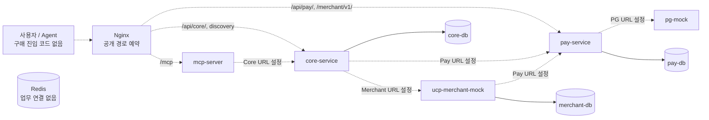
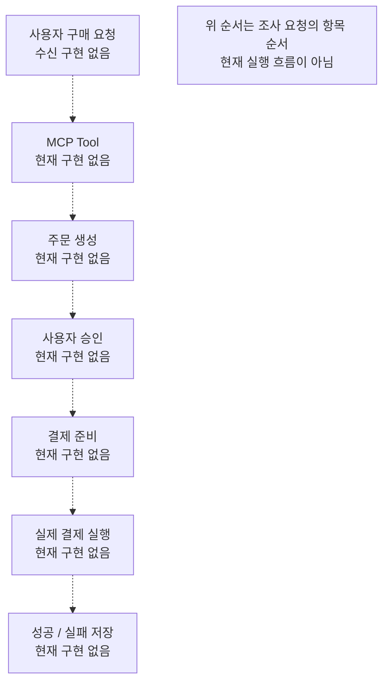
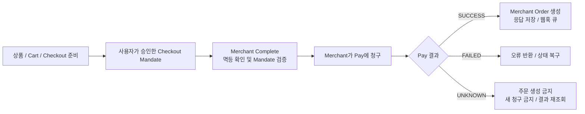

# 현재 Payment MCP 구조와 결제 흐름 조사

조사일: 2026-09-09 · 브랜치: `docs/fraud-architecture` · 기준 HEAD: `9150e4768ac5dcf360123c133a444fcc36fcae1c`

## 1. 결론과 조사 범위

**현재 저장소에는 실행 가능한 구매·결제 비즈니스 흐름이 없다.** Spring Boot 애플리케이션 5개, 계약 라이브러리 4개, DB 연결과 Flyway 기준 파일, Docker·Nginx·GitLab CI/CD 기반이 있다. 구매 요청 수신, 업무용 MCP Tool, 주문 생성, 사용자 승인, 결제 준비·실행·결과 저장은 모두 **현재 구현 없음**이다. 루트 README의 “비즈니스 기능은 아직 구현하지 않았다”는 설명을 전체 Java 소스와 SQL에서 확인했다.

이 문서는 현재 코드·설정과 저장소에 이미 존재하는 설계를 구분한다. 향후 Fraud 구조는 [fraud_architecture_plan.md](fraud_architecture_plan.md)에만 제안한다.

| 표시 | 의미 |
| --- | --- |
| 구현/설정 존재 | 현재 작업 트리의 소스 또는 설정에서 확인 |
| 기존 설계만 존재 | README, DESIGN.md, DBML에 설명은 있으나 실행 코드·DDL은 없음 |
| 현재 구현 없음 | 조사한 소스에서 해당 기능을 찾지 못함 |

전체 디렉터리, 숨김 설정, Git 추적 목록, Java 소스 전체, Gradle 의존성, 애플리케이션 설정 전체, migration 전체, 서비스·계약 README, Merchant DESIGN/DBML, ingress, 배포·CI 스크립트를 조사했다. `src/main`의 Java 파일은 9개이며 시작 클래스 5개와 `package-info.java` 4개다. `src/test`에는 Java 테스트 파일 5개가 있다.

조사는 현재 작업 트리의 정적 분석이다. 다른 브랜치, 실행 중인 DB, 배포 서버 상태를 현재 구현으로 간주하지 않았다. Docker 기동·실제 결제·외부 API 요청은 실행하지 않았다.

- 작업 시작 전부터 `ai/docs/fraud_scenario.md`가 삭제된 상태였다. 복구하거나 변경하지 않았다.
- Git에서 제외된 `ai/data/fraud_feature_spec.csv`, `fraud_model_features_erd_common.csv`, `fraud_scenario_matrix.csv`의 존재를 확인했다. **사용자 후속 지시에 따라 수집된 AI 데이터와 연결된 DB·피처 매핑은 설계 근거 및 재사용 대상에서 제외한다.** 이 파일은 현재 서비스 DB의 증거가 아니다.
- Merchant DESIGN이 참조하는 “프로젝트 설계서 v2.1” 원문은 조사한 작업 트리에서 발견되지 않았다. 그 문서의 함수·Entity·전체 흐름을 추정하지 않았다.

## 2. 전체 아키텍처와 재사용 가능한 기반

### 2.1 저장소 구조

| 위치 | 확인 결과 |
| --- | --- |
| `backend/apps/core-service/` | 구매 흐름 조정용 Spring Boot 실행 기반 |
| `backend/apps/mcp-server/` | Agent-facing adapter용 Spring Boot 실행 기반 |
| `backend/apps/pay-service/` | 승인·mandate·credential·결제 담당 실행 기반 |
| `backend/mocks/ucp-merchant-mock/` | Merchant 실행 기반과 상세 설계/DBML/ERD |
| `backend/mocks/pg-mock/` | PG 시뮬레이터 실행 기반. 결제 응답 시뮬레이션은 현재 구현 없음 |
| `backend/libs/` | UCP, Payment Handler, 내부 API, 테스트 지원의 plain Java 모듈 |
| `frontend/`, `mobile/` | README와 자리표시자. 프레임워크·구매 화면·승인 화면은 현재 구현 없음 |
| `ai/` | 역할별 작업 공간. 서비스/추론 코드와 backend 연결은 현재 구현 없음 |
| `infra/` | Docker 안내, Nginx 설정, GitLab CI. 모니터링은 미선정 |
| `scripts/` | 개발 DB/Redis bootstrap 및 서비스 이미지 배포 |
| `docs/` | 아키텍처·계약·프로토콜·작업 규칙과 기획 문서 |

### 2.2 서비스 경계

아래 점선은 **문서상 허용 호출 방향과 base URL 설정**이다. HTTP client와 업무 API가 구현되어 연결된 상태를 뜻하지 않는다. 실선은 Compose의 DB 연결 설정이다.

근거: [아키텍처와 소유권](../architecture/README.md), [docker-compose.yml](../../docker-compose.yml), 각 서비스 `application.yml`.

| 서비스 | 문서상 책임 | 소유 DB | 설정된 호출 대상 |
| --- | --- | --- | --- |
| MCP | Agent 요청을 Core 계약으로 변환 | 없음 | Core |
| Core | UCP 플랫폼, 구매 orchestration | `core-db` | Pay, Merchant |
| Pay | AP2-like 권한, mandate, credential, 결제 처리 | `pay-db` | PG |
| Merchant Mock | 상품·장바구니·checkout·주문의 원본 | `merchant-db` | Pay |
| PG Mock | 외부 PG 시뮬레이션 | 없음 | 없음 |

서비스 구현 모듈 사이의 Gradle 의존성은 금지되어 있다. HTTP로 통신하고 DTO·schema만 공유한다. Entity, Repository, Domain/Application Service는 공유 라이브러리에 둘 수 없다. 각 서비스는 자기 DB만 조회·변경한다. Merchant의 Core 주문 웹훅은 상세 DESIGN에 추가로 설명되어 있지만 호출 코드와 webhook URL 설정은 현재 구현 없음이다.

### 2.3 기술 스택

| 영역 | 실제 설정 | 근거/한계 |
| --- | --- | --- |
| 언어 | Java 21, UTF-8 | `backend/build.gradle`의 toolchain/release |
| 빌드 | Gradle 9.3.1 Wrapper, 멀티 프로젝트 9개 | `settings.gradle`, `gradle-wrapper.properties` |
| 웹 | Spring Boot 4.1.1, Web starter, Actuator | version catalog와 앱별 `build.gradle` |
| DB 접근 | JDBC starter | Core/Pay/Merchant에 존재. JPA 의존성·Entity는 현재 구현 없음 |
| Migration | Flyway Core + PostgreSQL 모듈 | Core/Pay/Merchant에 활성화 |
| DB | PostgreSQL `17-alpine`, DB 3개 | Compose 설정. 실행 중 schema를 조회한 결과는 아님 |
| Redis | `7.4-alpine`, AOF 및 volume | Redis client 의존성·세션·lock·캐시 사용은 현재 구현 없음 |
| Ingress | Nginx `1.28-alpine` | HTTP 80 수신. 레포에 TLS 설정 없음 |
| 컨테이너 | Temurin 21 JDK/JRE Alpine, 다단계 빌드, 비루트 app 사용자 | 각 Dockerfile |
| 테스트/품질 | Spring Boot Test starter, JUnit Platform, Checkstyle 13.9.0 | 테스트 5개는 클래스 존재 확인만 수행 |
| 배포 | GitLab CI/CD → 이미지 압축 artifact → SSH/SCP → 개발 EC2 | 운영 배포 정의 없음 |
| MCP/UCP/AP2 | 책임과 기획/설계 문서 | MCP SDK·업무 Tool·실행 프로토콜 계약은 현재 구현 없음 |
| Fraud/LLM | 해당 의존성 없음 | Sift/OpenAI SDK, client, 설정, 정책 모두 현재 구현 없음 |
| Frontend/Mobile/AI runtime | 미선정 또는 자리표시자 | 실제 패키지/실행 구성 없음 |

### 2.4 재사용 판정

재사용 가능한 것은 **서비스 경계, package root, 계약 모듈, JDBC/Flyway 기반, 설정 주입 패턴, Docker/CI, 테스트 배치 규칙**이다. 재사용할 구매·승인·결제 함수, 사용자/결제 Repository, 공통 API client, Fraud 모델은 현재 구현 없음이다.

Merchant의 “결제 성공 후 주문 생성”, 동일 checkout 멱등 키, 승인한 checkout 내용 보존, `UNKNOWN` 복구 규칙은 기존 설계로 존중해야 한다. 이는 이미 동작하는 보장이라는 뜻은 아니다. 수집된 AI DB와 CSV 기반 매핑은 재사용 대상에서 제외한다.

## 3. Payment MCP 진입점과 실제 코드 추적

### 3.1 존재하는 실행 진입 클래스

아래 클래스는 모두 7행에 선언되고 9행의 `main(String[] args)`에서 `SpringApplication.run(...)`만 호출한다.

| 서비스 | 실제 파일 | Class / Function |
| --- | --- | --- |
| MCP | [McpServerApplication.java](../../backend/apps/mcp-server/src/main/java/com/copenhagen/mcp/McpServerApplication.java) | `com.copenhagen.mcp.McpServerApplication.main(String[] args)` |
| Core | [CoreServiceApplication.java](../../backend/apps/core-service/src/main/java/com/copenhagen/core/CoreServiceApplication.java) | `com.copenhagen.core.CoreServiceApplication.main(String[] args)` |
| Pay | [PayServiceApplication.java](../../backend/apps/pay-service/src/main/java/com/copenhagen/pay/PayServiceApplication.java) | `com.copenhagen.pay.PayServiceApplication.main(String[] args)` |
| Merchant | [UcpMerchantMockApplication.java](../../backend/mocks/ucp-merchant-mock/src/main/java/com/copenhagen/merchantmock/UcpMerchantMockApplication.java) | `com.copenhagen.merchantmock.UcpMerchantMockApplication.main(String[] args)` |
| PG | [PgMockApplication.java](../../backend/mocks/pg-mock/src/main/java/com/copenhagen/pgmock/PgMockApplication.java) | `com.copenhagen.pgmock.PgMockApplication.main(String[] args)` |

`McpServerApplication.main`은 **서버 기동 진입점**이다. MCP 메시지나 결제 Tool 처리 함수가 아니다. Tool 등록, handler, Controller, transport/session 처리는 현재 구현 없음이다.

### 3.2 공개 ingress

[infra/nginx/nginx.conf](../../infra/nginx/nginx.conf)의 실제 `location` 설정:

| 경로 | 대상 | 행 | 현재 업무 handler |
| --- | --- | --- | --- |
| `/.well-known/ucp` | Core | 29 | 현재 구현 없음 |
| `/mcp` prefix | MCP | 36 | 현재 구현 없음 |
| `/api/core/` prefix | Core | 43 | 현재 구현 없음 |
| `/api/pay/` prefix | Pay | 50 | 현재 구현 없음 |
| `/merchant/v1/` prefix | **Pay** | 57 | 현재 구현 없음 |
| `/internal`, `/internal/` prefix | Nginx가 404 반환 | 21, 25 | 외부 차단 설정 존재 |
| 그 외 | Nginx가 404 반환 | 64 | 기본 차단 설정 존재 |

`/merchant/v1/`은 Merchant Mock으로 보내는 경로가 아니다. 외부 Merchant가 Pay에 접근하는 경계다. 따라서 향후 Core만 검사하면 이 결제 진입 경로의 최종 통제를 보장할 수 없다.

각 앱에는 Actuator의 `health,info` 노출 설정과 health probe 설정이 있다. Compose healthcheck는 컨테이너 내부 `/actuator/health`를 호출한다. 업무 경로의 404는 루트 README와 Controller 부재로 확인한 예상 동작이며, 이번 조사에서 실제 HTTP 요청으로 검증하지 않았다.

### 3.3 요청한 단계별 함수 추적 결과

| 요청 단계 | 조사한 실제 파일/위치 | 실제 Class / Function | 판단 |
| --- | --- | --- | --- |
| 사용자 구매 요청 | `frontend/README.md`, `mobile/README.md`, Nginx 36/43행, MCP/Core 시작 클래스 | 구매 요청 수신 Class/Function **현재 구현 없음** | 화면·대화 수신·구매 Controller 없음 |
| MCP Tool 호출 | `backend/apps/mcp-server/src/main/java/com/copenhagen/mcp/McpServerApplication.java`, 같은 모듈 `build.gradle` | `McpServerApplication.main`만 존재. 업무 Tool 함수 **현재 구현 없음** | Tool 이름·인자·Core API 매핑 없음 |
| 주문 생성 | Merchant 시작 클래스, `DESIGN.md` 39/105행, `schema.dbml` 154행 | 주문 생성 Class/Function **현재 구현 없음** | `orders`는 DBML 설계만 존재 |
| 사용자 승인 | Pay 시작 클래스, `backend/apps/pay-service/README.md`, `docs/project-overview.md` | 승인 Class/Function **현재 구현 없음** | PIN·생체인증·승인 세션·Mandate 발급 코드 없음 |
| 결제 준비 | Core/Pay 시작 클래스 및 두 모듈의 계약 의존성 | 준비 Class/Function **현재 구현 없음** | 검증된 checkout 증거·credential 준비 코드 없음 |
| 실제 결제 실행 | Pay 시작 클래스, Pay `application.yml` 21~23행, PG 시작 클래스 | 결제 실행 Class/Function **현재 구현 없음** | PG base URL만 존재. 호출 client와 PG 업무 endpoint 없음 |
| 결제 성공/실패 저장 | Pay/Merchant `V1__baseline.sql`, Merchant `DESIGN.md` 383행 이하 | 결과 저장 Class/Function **현재 구현 없음** | 상태·Repository·트랜잭션·DDL 없음 |

존재하지 않는 `PaymentService.executePayment`, `createOrder`, `approvePayment` 같은 이름을 현재 호출 경로로 사용하지 않는다.

### 3.4 기존 Merchant 설계가 규정한 순서

**기존 설계만 존재:** [Merchant DESIGN.md](../../backend/mocks/ucp-merchant-mock/DESIGN.md) §2, §3.2, §7~8은 다음을 규정한다.

이 다이어그램도 실행 코드를 의미하지 않는다. 설계상 **결제 전에 만들어지는 것은 Cart/Checkout이며, Order는 Pay 성공 이후 생성**한다. 사용자 요청의 “주문 생성 → 승인 → 결제”를 현재 시스템의 실거래 Order 생성 순서라고 기록할 수 없다. 승인 API와 Core의 세부 준비 순서는 아직 추적 가능한 코드가 없다.

## 4. 사용자·주문·결제 Entity 및 DB schema

### 4.1 실제 DDL과 영속 계층

| DB 소유 서비스 | 실제 migration | 내용 | Entity / Repository |
| --- | --- | --- | --- |
| Core | [V1__baseline.sql](../../backend/apps/core-service/src/main/resources/db/migration/V1__baseline.sql) | 업무 테이블을 만들지 않는다는 주석 1행 | 현재 구현 없음 |
| Pay | [V1__baseline.sql](../../backend/apps/pay-service/src/main/resources/db/migration/V1__baseline.sql) | 같은 취지의 주석 1행 | 현재 구현 없음 |
| Merchant | [V1__baseline.sql](../../backend/mocks/ucp-merchant-mock/src/main/resources/db/migration/V1__baseline.sql) | 같은 취지의 주석 1행 | 현재 구현 없음 |

SQL 전체에 업무용 `CREATE TABLE`이 없다. 사용자, 주문, 결제, 승인, mandate, credential 업무 테이블은 **현재 구현 없음**이다. Flyway가 런타임에 관리할 메타데이터는 업무 schema와 다르며, 실제 DB에 접속해 존재를 확인하지 않았다.

### 4.2 Merchant DBML — 기존 설계이며 미적용

근거: [schema.dbml](../../backend/mocks/ucp-merchant-mock/schema.dbml), [DESIGN.md §5](../../backend/mocks/ucp-merchant-mock/DESIGN.md).

| 설계 테이블 | 주요 필드와 제약 |
| --- | --- |
| `products` | `id` PK, `external_id` UNIQUE, `base_price` BIGINT, `currency`, `variants_json` JSONB |
| `carts` | `id` PK, `platform_ref` UNIQUE, `status`, `items_json`, `expires_at` |
| `checkout_sessions` | `id` PK, `cart_id`, `buyer_ref`, `status`, `total_amount`, `currency`, `canonical_checkout`, `checkout_digest`, `merchant_authorization_jws`, `expires_at`, `version` |
| 같은 checkout의 결제/멱등 필드 | `completion_key` UNIQUE, `completion_request_hash`, `completion_response_json`, `payment_status`, `pay_payment_id`, `processor_transaction_id`, `payment_error_code`, `payment_attempt_count`, `payment_requested_at` |
| `orders` | `id` PK, `checkout_session_id` UNIQUE, `status`, `total_amount`, `currency`, `raw_order_json`, `version` |
| `webhook_deliveries` | `webhook_id` PK, `order_id`, `event_type`, `payload_json`, 서명 필드, `status`, `attempt_count`, `next_attempt_at` |

설계 참조 관계는 `checkout_sessions.cart_id → carts.id`, `orders.checkout_session_id → checkout_sessions.id`의 1:1, `webhook_deliveries.order_id → orders.id`다. `buyer_ref`는 불투명 참조이며 사용자 Entity나 인증 주체의 구현 증거가 아니다. Merchant의 `payment_attempt_count`는 **결제 재청구 횟수가 아닌 결과 조회 횟수**다.

이 DBML은 Java Entity도 Flyway DDL도 아니다. Pay의 결제 원장 schema나 사용자 DB schema는 별도로 발견되지 않았다. 수집된 AI DB에서 그 빈자리를 채우지 않는다.

## 5. 멱등성·인증·정책·외부 호출

| 조사 항목 | 현재 구현/설정 | 기존 문서에만 있는 내용 |
| --- | --- | --- |
| Idempotency | **현재 구현 없음**. 필터, service, DB unique DDL, 재응답 저장, lock 없음 | Merchant Complete 응답 재생, 같은 키/다른 본문 409, `merchant-checkout-{checkoutId}` 고정, 동일 checkout 주문 1개 |
| 사용자 인증 | **현재 구현 없음**. Spring Security 의존성, OAuth/JWT/session 처리, PIN·생체인증 endpoint 없음 | 기획상 사용자 직접 승인·최종 인증 필요. Agent OAuth는 Merchant 책임이 아니라는 설명 |
| 서비스/Merchant 인증 | **현재 구현 없음**. Docker DNS와 외부 `/internal` 차단만 있음 | Core→Merchant API Key + `UCP-Agent` 바인딩은 합의 대기. Pay 토큰 endpoint·수명도 미확정 |
| 사용자 승인 | **현재 구현 없음** | Pay 책임으로 mandate/credential/권한 부여 정의 |
| Policy / Validation | **현재 구현 없음**. 입력 DTO, validation 규칙, 금액 한도, 서명 검증 코드 없음 | Merchant Mandate 검증 8항목, expiry, 금액·통화·checkout 비교, 조건부 상태 갱신 |
| 외부 API client | **현재 구현 없음**. RestClient/WebClient/Feign/client Bean 없음 | base URL만 설정. Merchant의 `paymenthandler/` 패키지는 설계 후보 |
| Timeout / Retry / Circuit breaker | 업무 호출에는 **현재 구현 없음** | Merchant 결과 불명 재조회·웹훅 backoff 설계. Compose healthcheck timeout은 API timeout이 아님 |

Merchant 설계의 검증 8항목은 capability 협상, Mandate 존재, 신뢰하는 Platform 서명키, 만료, Checkout ID, digest, 금액·통화·line item, 원래 Merchant Authorization 포함 여부다. 실제 검증 함수는 없다.

DESIGN §3.2는 Merchant 검증과 Pay 청구 사이에 다른 I/O를 넣지 않도록 한다. §6.3/§11에는 checkout digest 범위와 JCS 라이브러리, 인증 계약, 재조회 방식이 미확정으로 남아 있다. 향후 구현에서는 이 문서상 미확정을 해결해야 한다.

## 6. Error Handling과 Logging

**업무 Error Handling은 현재 구현 없음**이다. 사용자 정의 Exception, `@ControllerAdvice`, `@ExceptionHandler`, 공통 오류 DTO, 외부 오류 변환을 찾지 못했다. Spring Boot의 기본 오류 처리 기반과 Nginx의 명시적 404 설정만 있다.

Merchant DESIGN §10에는 `errorCode, message, currentState, nextAction, retryable, traceId` 오류 Envelope와 `IDEMPOTENCY_KEY_CONFLICT`, `PAYMENT_UNKNOWN` 등의 코드가 설계되어 있다. 이 문서의 `retryable=false` 규칙을 이미 구현된 공통 계약으로 간주하면 안 된다.

**사용자 정의 Logging 구조는 현재 구현 없음**이다. 애플리케이션 logger 호출, JSON 로그 설정, MDC/trace 전파, audit 저장, masking filter, Logback 설정 파일을 찾지 못했다. Spring Boot 기본 로그 기반과 `docker compose logs` 운영 안내만 있다. Nginx도 custom `log_format`/추적 설정이 없다.

`X-Forwarded-For` 전달 설정은 있지만 신뢰 프록시 판정이나 검증된 사용자 IP 추출 코드는 없다. 이를 즉시 신뢰할 수 있는 Fraud 피처로 기록할 수 없다. 민감정보 로그 금지는 AGENTS/기여 가이드/Merchant DESIGN의 규칙이며, 자동 마스킹 구현은 아니다.

## 7. Test 구조와 검증 범위

모든 테스트는 해당 서비스의 `src/test/java`에 있다.

| 실제 파일 | Class / Function |
| --- | --- |
| [CoreServiceApplicationTest.java](../../backend/apps/core-service/src/test/java/com/copenhagen/core/CoreServiceApplicationTest.java) | `CoreServiceApplicationTest.applicationEntryPointExists()` |
| [McpServerApplicationTest.java](../../backend/apps/mcp-server/src/test/java/com/copenhagen/mcp/McpServerApplicationTest.java) | `McpServerApplicationTest.applicationEntryPointExists()` |
| [PayServiceApplicationTest.java](../../backend/apps/pay-service/src/test/java/com/copenhagen/pay/PayServiceApplicationTest.java) | `PayServiceApplicationTest.applicationEntryPointExists()` |
| [UcpMerchantMockApplicationTest.java](../../backend/mocks/ucp-merchant-mock/src/test/java/com/copenhagen/merchantmock/UcpMerchantMockApplicationTest.java) | `UcpMerchantMockApplicationTest.applicationEntryPointExists()` |
| [PgMockApplicationTest.java](../../backend/mocks/pg-mock/src/test/java/com/copenhagen/pgmock/PgMockApplicationTest.java) | `PgMockApplicationTest.applicationEntryPointExists()` |

각 메서드는 10행에 있으며 `assertNotNull(대상Application.class)`만 실행한다. Spring context 기동, HTTP, DB migration, 실제 결제, 승인·보안, 동시 요청, 재시도, Fraud 테스트는 **현재 구현 없음**이다. `test-support`에는 package 안내만 있다.

GitLab CI는 repository whitespace 검사, backend 변경 시 Checkstyle, 변경 영향 모듈 test/bootJar를 구성한다. Merchant DESIGN §12의 테스트 목록은 향후 완료 기준이며 테스트 코드가 아니다.

이번 문서 작업은 링크·근거·Mermaid·변경 범위를 검증 대상으로 한다. 기능 코드가 없는 결제 흐름을 테스트 통과로 증명할 수 없으며, 이 조사에서는 Gradle build나 Docker 통합 실행을 수행하지 않았다.

## 8. 환경변수 관리

| 파일/위치 | 실제 방식 |
| --- | --- |
| Core `application.yml` | `CORE_DB_URL/USER/PASSWORD`, `PAY_SERVICE_URL`, `MERCHANT_SERVICE_URL` placeholder |
| MCP `application.yml` | `CORE_SERVICE_URL` placeholder |
| Pay `application.yml` | `PAY_DB_URL/USER/PASSWORD`, `PG_SERVICE_URL` placeholder |
| Merchant `application.yml` | `MERCHANT_DB_URL/USER/PASSWORD`, `PAY_SERVICE_URL` placeholder |
| `docker-compose.yml` | 환경변수로 DB 자격/이미지/Nginx port 주입. 서비스 URL은 Docker DNS 값으로 전달 |
| `.gitignore` | `.env`, `.env.*`, key/pem, runtime data 제외. `.env.example` 예외 |
| `infra/docker/ec2.env.example` | DB/port/image 변수 예시. 실제 비밀값은 기록하지 않음 |
| `scripts/bootstrap-dev-infra.sh` | env 파일 존재와 미교체 placeholder 검사 |
| `scripts/deploy-dev-service.sh` | env 파일 권한 제한, 이미지 변수 갱신, healthcheck 후 확정/실패 시 이전 이미지 복구 시도 |
| GitLab CI/CD Variables | 배포 host/user/path, SSH key/known hosts 등 주입 안내 |

**Sift/OpenAI 키·모델·timeout·Fraud 정책 환경변수는 현재 구현 없음**이다. API 키를 설정해도 앱에 자동 전달되는 구조가 아니며, 향후 앱 placeholder와 Compose 환경 전달을 함께 정의해야 한다.

## 9. 핵심 근거 파일

| 근거 파일 | 조사한 내용 |
| --- | --- |
| [README.md](../../README.md), [CONTRIBUTING.md](../../CONTRIBUTING.md) | 현재 미구현 선언, 모듈·DB·계약·설정·테스트 규칙 |
| [docs/architecture/README.md](../architecture/README.md) | 허용 호출 방향, 공유 구현 금지, DB 소유권 |
| [docs/project-overview.md](../project-overview.md) | 사용자 요청→승인·인증→결제라는 기획 의도 |
| [backend/settings.gradle](../../backend/settings.gradle), [build.gradle](../../backend/build.gradle), [libs.versions.toml](../../backend/gradle/libs.versions.toml) | 9개 모듈, Java/Gradle/Spring 기반 |
| 위 §3.1의 Application.java 5개 | 실제 시작 Class/Function과 업무 구현 부재 |
| [Core 설정](../../backend/apps/core-service/src/main/resources/application.yml), [MCP 설정](../../backend/apps/mcp-server/src/main/resources/application.yml), [Pay 설정](../../backend/apps/pay-service/src/main/resources/application.yml), [Merchant 설정](../../backend/mocks/ucp-merchant-mock/src/main/resources/application.yml) | DB와 outbound base URL, Actuator |
| 위 §4.1의 migration 3개 | 업무 DDL 부재 |
| [Merchant DESIGN.md](../../backend/mocks/ucp-merchant-mock/DESIGN.md), [schema.dbml](../../backend/mocks/ucp-merchant-mock/schema.dbml) | 기존 주문/결제/검증/멱등/복구 설계와 미확정 사항 |
| [internal-api-contract](../../backend/libs/internal-api-contract/README.md), [payment-handler-contract](../../backend/libs/payment-handler-contract/README.md), [ucp-contract](../../backend/libs/ucp-contract/README.md) | 공유 가능한 계약 범위. 실제 DTO는 없음 |
| [Nginx](../../infra/nginx/nginx.conf), [Compose](../../docker-compose.yml) | 외부 ingress, DB/Redis, healthcheck |
| [CI 공통 설정](../../infra/gitlab/common.gitlab-ci.yml), [배포 스크립트](../../scripts/deploy-dev-service.sh), [모니터링 안내](../../infra/monitoring/README.md) | 검사·배포·운영 로그 기반과 모니터링 부재 |

## 10. 요청 항목 확인표

| # | 항목 | 기록 위치 |
| --- | --- | --- |
| 1 | 전체 architecture | §2 |
| 2 | 기술 stack | §2.3 |
| 3 | Payment MCP 진입점 | §3.1~3.2 |
| 4 | 사용자 구매 요청 위치 | §3.3 |
| 5 | 주문 생성 위치 | §3.3~3.4 |
| 6 | 사용자 승인 위치 | §3.3, §5 |
| 7 | 실제 결제 실행 함수 | §3.3 |
| 8 | 사용자/주문/결제 Entity·schema | §4 |
| 9 | Idempotency | §5 |
| 10 | 사용자 인증 | §5 |
| 11 | Policy/Validation | §5 |
| 12 | 외부 API client | §5 |
| 13 | Error Handling | §6 |
| 14 | Logging | §6 |
| 15 | Test | §7 |
| 16 | 환경변수 | §8 |
