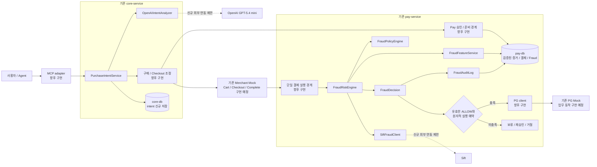
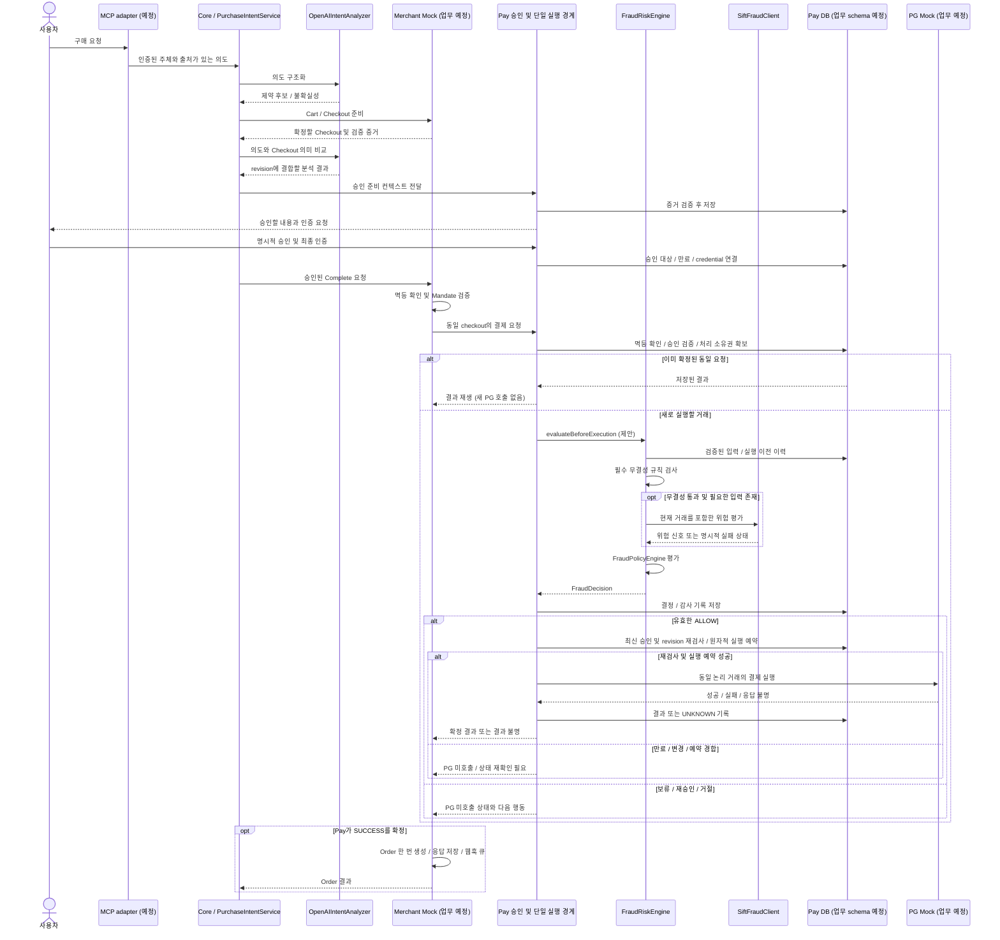

# Payment MCP Fraud Detection 아키텍처 제안

작성일: 2026-09-09 · 상태: **설계 제안, 미구현** · 조사 기준: `9150e4768ac5dcf360123c133a444fcc36fcae1c`

## 1. 설계 전제와 권장 위치

현재 상태는 [current_payment_flow.md](current_payment_flow.md)에 기록했다. **기존 결제 실행 함수가 없으므로 지금 특정 함수에 Fraud 호출을 추가할 수는 없다.** 이 문서는 기존 서비스 책임을 유지하면서 향후 결제 구현에 적용할 배치와 필수 조건을 제안한다. 아래 신규 클래스·함수·DTO·테이블·상태·환경변수 이름은 모두 후보이며 현재 존재하지 않는다.

권장 배치는 **Core에서 구매 의도와 OpenAI 분석을 관리하고, Pay에서 Sift·피처·정책·최종 FraudRiskEngine·감사를 관리**하는 방식이다. 신규 배포 서비스, 별도 AI DB, 새로운 최상위 모듈은 제안하지 않는다.

**사용자 후속 지시 반영:** 수집된 `ai/data` 데이터셋과 그에 연결된 기존 AI DB·피처 매핑은 사용하지 않는다. 기존 데이터 이관·학습·CSV 로딩·해당 schema 재현도 계획에 포함하지 않는다. 필요한 입력은 향후 Core/Pay/Merchant가 실제 서비스 흐름에서 소유·검증하는 데이터와 허용된 외부 위험 신호로 새로 정의한다.

| 기존 근거 | 이번 제안에 주는 제약 |
| --- | --- |
| [MCP README](../../backend/apps/mcp-server/README.md), [아키텍처](../architecture/README.md) | MCP는 Core만 호출. 도메인 규칙/DB/Fraud 최종 결정은 두지 않음 |
| [Core README](../../backend/apps/core-service/README.md) | 구매 orchestration과 의도 관리는 Core 안에 배치 |
| [Pay README](../../backend/apps/pay-service/README.md) | 결제 권한·credential·결제 처리 경계에 최종 gate 배치 |
| [Merchant DESIGN §2, §3.2](../../backend/mocks/ucp-merchant-mock/DESIGN.md) | Order는 Pay 성공 후 생성. Merchant 검증과 Pay 청구 사이에 별도 Fraud I/O 삽입 금지 |
| [기여 가이드](../../CONTRIBUTING.md) | 서비스별 DB 소유권, HTTP 계약, 공유 비즈니스 구현 금지, 기존 migration 수정 금지 |
| 현재 JDBC/Flyway 의존성 | 서비스 내부 JDBC 영속화를 우선 검토. Fraud 때문에 JPA를 새 전제로 삼지 않음 |

Core→OpenAI와 Pay→Sift는 **현재 허용 outbound 목록에 없는 외부 연결 추가 제안**이다. 구현 전에 해당 서비스 README/아키텍처 문서와 ADR에 책임·egress·데이터 전달 범위를 합의해야 한다. 현재 승인된 호출 방향으로 표시하지 않는다. 기존 앱 간 호출 방향과 DB 경계는 유지한다.

## 2. 삽입 지점 비교

| 후보 위치 | 장점 | 제약 | 판단 |
| --- | --- | --- | --- |
| MCP Tool 내부 | 사용자 요청과 가까움 | Core/Pay 직접 진입을 통제하지 못하며 MCP의 도메인 규칙 금지와 충돌 | 전달·입력 형식 검증만 |
| Core 구매 흐름 | 의도·checkout 준비·사용자 확인을 조정하기 좋음 | Merchant→Pay 청구와 Pay 공개 경로까지 최종 강제할 수 없음 | 의도 분석과 사전 준비 |
| Merchant Complete 내부 | checkout과 가까움 | 외부 Merchant 책임에 플랫폼 Fraud 구현이 들어감. 기존 DESIGN의 I/O 순서와 충돌 | 기존 Mandate 검증·멱등·결과 처리 유지 |
| **Pay의 PG 호출 직전** | Core와 Merchant에서 들어온 결제 요청의 공통 실행 경계 | 단일 실행 경로·승인 검증·영속화 기반을 먼저 구현해야 함 | **최종 필수 Fraud gate** |
| PG Mock | 모든 모의 청구를 관찰할 수 있음 | 외부 PG 시뮬레이터이며 제품 정책을 소유하면 안 됨 | 테스트용 응답·호출 횟수 검증만 |

Pay의 향후 모든 청구·승인·capture 등 **새로 금전 효과를 만드는 PG 호출 경로**는 공통 결제 실행 경계를 사용하도록 한다. 각 controller가 직접 PG client를 호출하거나 worker가 gate를 우회하는 경로를 허용하지 않는다. 이미 보낸 거래의 결과 조회와 확정 응답 재생은 새로운 청구와 구분한다.

## 3. 컴포넌트 배치와 책임

다음 표의 8개 컴포넌트는 모두 **현재 구현 없음**이다. 함수명도 구현 시 검토할 제안이다.

| 컴포넌트 | 소유 서비스 / package 후보 | 제안 Function | 입력 → 출력 / 책임 |
| --- | --- | --- | --- |
| `PurchaseIntentService` | Core / `com.copenhagen.core.purchaseintent` | `captureIntent`, `analyzeCheckout` | 인증된 사용자 요청과 intent revision을 저장. 분석·사용자 확인·checkout 연결을 조정 |
| `OpenAIIntentAnalyzer` | Core / `com.copenhagen.core.purchaseintent.client` | `analyze` | 최소화한 요청/checkout → 구조화된 제약 추출·의미상 불일치·불확실성. 결제 승인 권한 없음 |
| `SiftFraudClient` | Pay / `com.copenhagen.pay.fraud.client` | `evaluate`, `reportOutcome` | 검증한 거래 컨텍스트 → Sift 점수/상태/추적 메타데이터. 최종 로컬 결정을 대신하지 않음 |
| `FraudFeatureService` | Pay / `com.copenhagen.pay.fraud.application` | `buildFeatures` | Pay 소유 데이터와 검증된 전달 증거 → 시점·출처·결측 상태가 있는 피처 스냅샷 |
| `FraudPolicyEngine` | Pay / `com.copenhagen.pay.fraud.domain` | `evaluate` | 승인 무결성 검증 결과, 명시적 제약, 피처, 외부 분석 → 결정론적 정책 결과. 외부 I/O 없음 |
| `FraudRiskEngine` | Pay / `com.copenhagen.pay.fraud.application` | `evaluateBeforeExecution` | 피처·Sift·정책을 조정하여 실행에 결합된 `FraudDecision` 생성. PG를 직접 호출하지 않음 |
| `FraudDecision` | Pay / `com.copenhagen.pay.fraud.domain` | 불변 값 객체 후보 | 행동, reason code, 근거·정책 버전, 유효기간, 대상 요청 식별. 단순 boolean 사용 금지 |
| `FraudAuditLog` | Pay / `com.copenhagen.pay.fraud.audit` | 감사 기록 모델 후보 | 평가·결정·gate 사용·결과를 추적하는 기록. Repository가 Pay DB에 append |

`FraudAuditLog`는 로그 출력 utility와 구분한다. `FraudDecision` 도메인 객체를 앱 간 Gradle dependency로 공유하지 않는다. 다른 서비스에는 `internal-api-contract`/필요한 `payment-handler-contract`에 최소 결과 DTO만 정의한다. Controller/client/Repository/정책 구현은 계약 모듈 밖에 둔다.

JDBC repository 구현 패턴과 하위 package convention은 Core/Pay에 아직 없다. 위 package 경로는 기존 `com.copenhagen.core`, `com.copenhagen.pay` 아래의 책임별 후보이며 새 표준을 확정한 것이 아니다.

### 3.1 제안 구조도

전체 화살표는 향후 제안이다. 기존 배포 단위 안에서 컴포넌트를 추가한다.

## 4. 구매 의도부터 결제 결과까지

### 4.1 의도·분석·승인 증거의 전달

1. 향후 MCP adapter는 인증된 요청 주체와 원본 사용자 요청의 출처를 보존하여 Core로 전달한다. Tool 인자의 `userId`나 Agent가 다시 쓴 요약만으로 사용자 신원을 확정하지 않는다. 신뢰할 원본 대화가 전달되지 않는 호스트라면 구매 의도가 이미 확인됐다고 처리할 수 없다.
2. Core의 `PurchaseIntentService`는 구매 의도와 revision을 보관하고 `OpenAIIntentAnalyzer`로 구조화한다. 명시되지 않은 예산·수량·판매처를 임의로 채우지 않는다. 분석 결과는 해석 후보이며 사용자가 확인한 제약과 구분한다.
3. 기존 Core→Merchant 경계로 상품·Cart·Checkout을 준비한다. **Order는 아직 없다.** 실제 가격·수량·통화·판매처는 검증할 Merchant checkout 스냅샷에서 얻는다.
4. 준비된 checkout과 의도를 비교하는 OpenAI 분석은 사용자 최종 승인 전에 완료해 revision에 결합한다. 모호한 의도나 의미상 변경은 사용자에게 확인한다. 정확한 금액·통화·수량·판매처 비교는 서버 규칙으로 수행한다.
5. Core는 향후 내부 계약으로 의도 제약·분석 결과·checkout 증거를 Pay의 승인/준비 경계에 전달한다. **Pay가 Core/Merchant DB를 직접 조회하거나, Pay→Core 조회 방향을 새로 만들지 않는다.**
6. Pay는 신뢰하는 Core 요청인지, 사용자·checkout·merchant와 증거가 일치하는지 확인하여 Pay 소유 스냅샷으로 보관한다. 사용자 승인은 Pay 책임의 향후 인증/승인 플로우에서 확인한다. 사용자에게 보여준 정확한 checkout revision과 승인 결과를 묶는다.
7. 이후 Merchant→Pay 청구는 승인/credential 참조로 Pay가 저장한 증거를 찾아 사용한다. Merchant가 보낸 `fraudApproved=true`, LLM 결과, 임의 점수를 신뢰하지 않는다. 사전 등록된 유효한 증거가 없으면 PG로 진행하지 않는다.

별도 공통 위험 점수 DB는 필요하지 않다. Core 소유의 의도와 Pay 소유의 결제 증거가 계약으로 연결되는 방식이며, 계약 자체와 인증/승인 구현은 현재 없다.

### 4.2 제안 sequence

이 시퀀스의 controller/service/메서드는 **향후 구현 역할**이다. 이미 존재하는 호출을 표현하지 않는다.

Core가 승인 완료를 확인하고 Complete를 호출하는 알림/조회 계약은 별도로 정의해야 한다. UI·승인 API·credential 전달 계약이 현재 있는 것으로 가정하지 않는다.

### 4.3 결제 직전 필수 gate와 동시성

**실행 조건 제안:** 해당 요청에 결합된 최신 `FraudDecision=ALLOW` + 유효한 사용자 승인/credential + 동일한 결제 내용 + 단일 실행 예약에 성공한 요청만 PG를 호출할 수 있다. Fraud ALLOW는 사용자 승인을 대신하지 않는다.

결정이 결합되어야 할 대상은 인증된 사용자, merchant, checkout 식별자, checkout/의도 revision, 승인/credential 참조, 금액·통화, 검증한 checkout digest, 정규화한 요청 hash, 논리 결제 식별자다. 결제 전 존재하지 않는 Order ID는 필수 키로 요구하지 않는다.

- 동일 merchant·멱등 키·같은 본문이면 완료 결과를 먼저 반환한다. 완료된 결제를 새 Fraud 평가 결과로 뒤집거나 PG로 다시 보내지 않는다.
- 동일 키·다른 본문은 충돌로 거절한다. 다른 키를 사용해도 같은 checkout/소비된 credential을 다시 청구할 수 없도록 결제 원장에 별도 단일성 제약을 둔다.
- 새 요청은 짧은 DB 트랜잭션으로 처리 소유권과 고정된 스냅샷을 확보한다. 중복 요청은 진행 상태를 조회한다. Redis lock이 이미 있다고 가정하지 않는다.
- Sift/OpenAI 네트워크 호출 중 DB 트랜잭션과 row lock을 계속 잡지 않는다. provider 응답 후에는 최신 승인·만료·취소·credential·revision을 다시 읽는다.
- 결정·감사 기록과 “이 결정으로 실행을 예약했다”는 상태를 원자적으로 결합한다. 조건부 UPDATE/unique constraint로 한 요청만 실행권을 얻는다. 저장 실패 또는 예약 경합 시 PG를 호출하지 않는다.
- 실행 예약 후 요청 스냅샷을 변경할 수 없도록 한다. 취소·승인 만료와 실행의 선후관계, 예약 후 호출까지의 최대 지연을 정의하고 지연 한도를 넘으면 gate로 돌아간다.
- 워커 재시작으로 실행권을 넘길 때 이미 PG 요청이 나갔을 가능성이 있으면 결과 조회/대사를 먼저 한다. lease 만료만으로 새 청구를 허용하지 않는다.
- **DB 트랜잭션과 PG 호출은 하나의 원자적 커밋이 아니다.** PG의 멱등 키·거래 조회·복구 계약을 구현하지 않고 exactly-once를 보장한다고 쓰면 안 된다.

평가 대상 내용이 변경되면 이전 결정과 승인은 사용할 수 없다. 변경된 구매 조건에 대한 새 승인 절차와, 동일 논리 결제의 네트워크 재시도를 구분해야 한다.

## 5. OpenAI와 Sift의 역할

이 절의 외부 제품 정보는 2026-09-09 공식 문서로 별도 확인했다. 현재 저장소 구현의 근거로 사용하지 않는다. 키·계정 권한·응답시간·상용 계약은 검증하지 않았다.

### 5.1 OpenAIIntentAnalyzer

모델은 요청한 **GPT-5.4 mini**, API 식별자 후보는 `gpt-5.4-mini`로 유지한다. 공식 모델 문서는 Responses API와 Structured Outputs 지원을 명시한다. 실제 도입 시 평가한 snapshot을 고정할 수 있도록 모델명을 설정으로 분리한다. [OpenAI 공식 모델 문서](https://developers.openai.com/api/docs/models/gpt-5.4-mini)

연동 후보는 Responses API + JSON Schema 기반 Structured Outputs다. 거절(refusal), 불완전 응답, schema/파싱 오류를 별도 처리해야 한다. 구조화된 출력이 의미의 정확성이나 사용자의 실제 승인을 보장하지는 않는다. [OpenAI Structured Outputs](https://developers.openai.com/api/docs/guides/structured-outputs)

**프로젝트 제안:**

- 입력: 개인정보를 최소화한 사용자 구매 표현, 사용자 확인 제약, checkout 상품·수량·금액·통화·판매처의 필요한 부분.
- 출력 후보: `intentRevision`, `analysisInputDigest`, 추출한 제약과 근거 위치, `deviationReasons`, `ambiguities`, `analysisStatus`. 서버가 요청 컨텍스트와 대조한다.
- 누락 예산을 무제한 허용으로, 낮은 확신을 정상으로 변환하지 않는다. 수치형 confidence가 있더라도 보정된 Fraud 확률처럼 사용하지 않는다.
- 모델에 PG·승인·credential 도구를 제공하지 않는다. 상품 설명·사용자 입력 속 지시문은 분석 대상 데이터로 취급하며 system 지시나 정책으로 승격하지 않는다.
- PIN, 카드 원문, 보안 코드, credential, access token, Mandate 전체, 상세 주소 원문을 보내지 않는다. 외부 저장 옵션·보관·접근 정책은 구현 전에 확인한다.
- 사용자 확인 이후 checkout이 바뀌면 이전 분석을 재사용하지 않는다. 고정된 분석 입력 digest, 모델·prompt·schema 버전을 기록한다.
- LLM timeout/거절/파싱 오류는 분석 미완료 상태다. 명시적 사용자 확인 또는 합의한 대체 절차를 완료하기 전에는 승인 준비를 통과하지 않는다. Pay는 필요한 분석 증거 누락도 차단한다.

SDK/HTTP client 라이브러리와 정확한 버전은 아직 선정하지 않는다. 기존 Java/Web 환경에서 서비스 내부 adapter를 구현하고 vendor DTO는 Core 내부에 한정한다.

### 5.2 SiftFraudClient

Sift는 이벤트와 함께 점수를 동기적으로 받는 방식과 별도 점수 조회를 제공한다. 이번 제안에서는 현재 거래 이벤트를 포함한 평가로 오래된 점수만 사용하는 위험을 줄인다. 동기 점수에는 사용자 식별이 필요하며 anonymous event의 동기 scoring은 지원되지 않는다. 활성화한 abuse product와 응답 상태도 확인해야 한다. [Sift Score API](https://developers.sift.com/docs/v204/curl/score-api)

Sift 가이드는 점수를 중요한 거래 지점에서 사용하고, Sift Workflow 또는 애플리케이션 정책으로 후속 행동을 정하는 방식을 설명한다. 이 프로젝트는 우선 Pay의 `FraudPolicyEngine`을 최종 결정 주체로 두는 안을 제안한다. [Sift Payment Gateway Guide](https://developers.sift.com/guides/payment-gateway)

**프로젝트 제안:**

- 검증한 사용자에 안정적인 가명 provider ID를 매핑한다. 임의 user ID, 공용 guest ID, 새로 생성한 우회 ID로 필수 식별을 채우지 않는다.
- payment abuse 관련 사용 권한, event 종류, 필수 필드, API version, 점수 범위와 상태 코드는 실제 계약/공식 schema에 맞춰 확정한다. 숫자 threshold를 임의로 고정하지 않는다.
- Pay에는 merchant+checkout+논리 결제 식별자가 먼저 존재하도록 하고 실제 Order ID는 성공 뒤 연결한다. Sift의 order 관련 필드가 필요하더라도 Merchant Order를 결제 전에 생성하지 않는다. provider용 참조와 도메인 Order의 의미·매핑을 별도로 합의한다.
- 금액은 결제 내부에서 minor unit 정수+통화를 유지한다. provider의 금액 단위와 통화 소수 자릿수에 맞춘 명시적 변환을 adapter에서 검증한다. 결제 원금을 부동소수 기반 AI 피처로 다시 계산하지 않는다.
- HTTP 성공만으로 정상 점수로 간주하지 않는다. provider body status, 필요한 score 존재, 입력 사용자/대상 일치, 평가 시각을 검증한다.
- timeout, 429, 5xx, 인증 오류, 잘못된 응답, 결측 score는 서로 구분하여 `HOLD` 근거로 남긴다. 실패를 0점이나 ALLOW로 치환하지 않는다.
- 전송 재시도에는 총 deadline, backoff, 재시도 상한을 둔다. provider 이벤트의 중복 처리 보장은 별도 확인하며 내부 event ID만으로 Sift가 자동 중복 제거한다고 가정하지 않는다.
- PG 확정 결과와 나중의 실제 Fraud 판정은 분리한다. 결제 성공을 정상 라벨로, 거절/실패를 사기 라벨로 자동 치환하지 않는다. feedback 전송 실패가 새 결제를 유발해서도 안 된다.

Sift webhook/수동 심사 연동은 현재 없다. 필요해지면 인증, 중복·순서 역전, 해당 거래/revision 연결, 업무 행동을 추가 설계한다. webhook의 승인 신호만으로 PG를 실행하는 우회 경로를 만들지 않는다.

## 6. FraudFeatureService 데이터 계약

아래 입력은 **향후 수집·계약 후보**다. 현재 수집된 AI DB를 사용하지 않으며, 현재 backend에서 이미 얻을 수 있다는 의미도 아니다.

| 피처/증거 | 원본 소유자 및 전달 | 현재 상태 / 필수 주의점 |
| --- | --- | --- |
| 사용자 주체와 요청 출처 | 향후 인증 계층 → Core → Pay의 신뢰 계약 | 인증 구현 없음. Tool 인자만 신뢰 금지 |
| 구매 의도와 확인한 제약 | Core가 revision 관리 → Pay 승인 준비에 전달 | 저장·DTO 없음. LLM 추론과 사용자가 확인한 사실 구분 |
| 금액·통화·상품·판매처·checkout digest | Merchant checkout → Core 검증 → Pay 검증·저장 | Merchant 설계만 존재. digest 범위 합의 필요 |
| 승인 상태·승인한 revision·만료·credential 바인딩 | Pay 소유 승인 데이터 | 구현 없음. Fraud용 별도 승인 truth를 만들지 않음 |
| 실행 전까지의 결제·시도 이력 | Pay 소유 결제 원장 | 구현 없음. 현재 거래의 미래 결과를 피처에 포함하지 않음 |
| 요청 시각·진행 중 중복·속도 신호 | Pay에서 정규화한 요청/시도 기록 | 집계 기간·시간대·동시 진행 거래 포함 기준 정의 필요 |
| 계정 연령 등 계정 속성 | 계정 소유 서비스와 인증 계약 확정 후 전달 | 사용자 Entity·소유권 미정. 0일로 가정 금지 |
| IP·기기·세션 신호 | 신뢰 ingress/사용자 client에서 수집 후 필요한 범위만 전달 | IP 추출/기기 SDK 구현 없음. Agent 서버 IP를 사용자 IP로 오인 금지 |
| Sift 신호 | Sift client가 실제 응답 검증 | 연동 없음. 누락·오래된 값·사용 불가 상태를 명시 |

`FraudFeatureService`는 Pay DB만 직접 읽는다. Merchant/Core의 테이블을 join하거나 수집된 CSV를 runtime feature source로 사용하지 않는다. 결측 값은 `missingFields`와 `sourceStatus`로 기록한다. 필수 증거 결측은 HOLD/거절로 처리하고 선택 피처 결측은 검증한 정책에 따라 판단한다.

평가 입력에는 `featureSchemaVersion`, `computedAt`, `asOf`, `evidenceDigest` 등을 두는 안을 제안한다. 감사에 필요한 최소한의 마스킹된 입력 스냅샷과 digest를 같이 보관한다. hash만 저장해 놓고 원래 판단을 재현할 수 있다고 주장하지 않는다.

## 7. 결정 모델과 정책 우선순위

`FraudDecision` 행동 후보:

| 행동 | 의미 | PG 호출 |
| --- | --- | --- |
| `ALLOW` | 모든 필수 승인·무결성 조건과 위험 정책 충족 | 최종 재검사/실행 예약 성공 시만 가능 |
| `DENY` | 명백한 무결성 위반·정책 위반 또는 검증된 차단 기준 | 금지 |
| `REQUIRE_REAPPROVAL` | 의도 불명확·승인 대상 변경 등 사용자 재확인 필요 | 새 유효 승인과 gate 통과 전 금지 |
| `HOLD` | provider/저장소 장애·필수 증거 결측·평가 불완료 | 복구 후 동일 논리 거래의 상태 확인 전 금지 |

우선순위는 (1) 신원/승인/무결성 필수 조건, (2) 명시적 한도·판매처·수량 규칙, (3) 의도와 checkout의 의미상 불일치, (4) Sift와 실행 전 행동 신호의 결합이다. 낮은 Sift 점수나 LLM의 “정상” 응답으로 1~2번 위반을 덮을 수 없다. 임계값·점수 조합·결정 TTL은 테스트와 운영 평가 후 설정하며 이 문서에서 숫자를 발명하지 않는다.

결정 모델 필드 후보는 `decisionId`, `action`, `reasonCodes`, `evaluatedAt`, `expiresAt`, `policyVersion`, `featureSchemaVersion`, `evidenceDigest`, `requestHash`, `providerStatus`, 해당 결제/승인/의도 revision 참조다. 필요 시 원점수와 모델/분석 참조를 분리 보관한다.

결제 상태와 Fraud 상태는 별개다. `HOLD`는 “PG 결제 실패”가 아니며, `ALLOW`는 “결제 성공”이 아니다.

## 8. 멱등성·장애·결과 저장

| 상황 | 처리 제안 | 기존 설계와의 관계 |
| --- | --- | --- |
| 동일 요청 중복 | merchant scope+key+request hash 확인, 완료 결과 재생/진행 상태 반환 | Merchant DESIGN §8의 키·응답 재생 원칙 유지 |
| 같은 키의 본문 변경 | 충돌 거절, 기존 결정 재사용 금지 | 기존 `IDEMPOTENCY_KEY_CONFLICT` 의미 유지 |
| Sift 평가 중 중복 | 하나의 평가 소유권, 고정 입력, 중복 요청은 진행 상태 확인 | 새로운 Pay 구현 필요 |
| 평가 후 입력/승인 변경 | 이전 decision 무효, 재승인/재평가 | 승인 대상 무결성 유지 |
| Sift 장애 또는 필수 분석 누락 | PG 미호출, HOLD와 기술 사유 기록 | 새 오류 상태/계약 필요 |
| 결정/감사 저장 실패 | PG 미호출 | 실행 증거 없이 청구 금지 |
| PG가 확정 실패 | 실패 및 provider 참조 저장, 허용한 복구 절차로 안내 | 새 원장 구현 필요 |
| PG timeout/응답 유실 | `UNKNOWN` 또는 동등한 결과 불명 상태. 동일 논리 거래 조회/대사 | 새 키 청구와 Order 생성 금지 |
| PG 성공 후 Pay DB 저장 실패 | 재시작 시 결과 불명으로 복구할 수 있는 실행 기록 유지. PG 결과 조회 후 확정 | 성공을 실패로 단정하거나 재청구 금지 |
| Pay 성공 후 Merchant 장애 | 같은 Complete 키의 조회/재응답으로 복구, 주문 단일성 보장 | 기존 `orders.checkout_session_id` UNIQUE 설계 유지 |
| 외부 feedback 실패 | 별도 재전송 기록으로 복구. 결제 결과 유지 | feedback 실패와 청구 재시도 분리 |

결제 전 HOLD와 PG 결과 UNKNOWN을 구분하는 계약이 필요하다. 현재 Merchant 설계의 `SUCCESS/FAILED/UNKNOWN`만으로 Fraud 보류의 다음 행동을 표현하기 어렵다. 기존 필드를 임의로 재해석하지 말고 Payment Handler 오류/상태 계약과 Merchant DESIGN에 제안·합의한 뒤 제공자와 소비자를 함께 구현한다.

특히 Merchant의 timeout은 Pay 내부 Sift 평가까지 포함한다. 전체 deadline을 바깥쪽 timeout보다 짧게 설계하되, Merchant가 기다리기를 중단했다고 Pay 작업이 자동 취소됐다고 가정하지 않는다. Merchant가 결과를 모르면 동일 키로 진행 상태를 확인하고 새 청구를 생성하지 않는다.

PG의 idempotency/조회 계약, Merchant의 POST 응답 유실 시 조회 방식은 현재 미확정이다. Fraud 구현을 먼저 완료했다고 이 복구 문제가 해결되는 것은 아니다.

## 9. 영속화와 DB migration

**이번 문서 브랜치: DB migration 없음. 향후 구현: 필요.** 사용자·승인·결제 기본 schema도 없으므로 해당 도메인 구현과 함께 순서를 정한다. 이미 있는 `V1__baseline.sql`은 수정하지 않고 소유 서비스에 다음 사용 가능한 버전으로 추가한다. 아래 테이블 이름은 후보이며 수집된 AI DB에서 가져온 schema가 아니다.

| 소유 DB | 신규 테이블/변경 후보 | 최소 저장 목적 |
| --- | --- | --- |
| Core DB | `purchase_intents` | intent 식별, 사용자 참조, revision, 확인된 제약, 상태, 생성/갱신 시각 |
| Core DB | `purchase_intent_analyses` | intent+checkout revision, 입력 digest, 모델/prompt/schema 버전, 구조화 결과와 실패 상태. 이력 분리가 필요하면 별도 테이블 |
| Pay DB | 향후 승인/결제 schema에 증거 연결 필드 또는 소유 스냅샷 | Core 출처 증거·승인 대상·credential·request hash·논리 거래 연결. 기존 테이블이 있다고 가정하지 않음 |
| Pay DB | `fraud_decisions` | 대상 거래/승인/revision, 행동, 사유, 유효기간, 평가 상태, 정책/피처 버전 |
| Pay DB | `fraud_audit_logs` | 평가·결정·실행권 사용·결과·복구의 순차 기록, trace 및 최소 증거 |
| Pay DB | `fraud_outbound_events` (feedback 재전송을 구현할 경우) | event ID, 결제/결정 참조, 최소 payload, 상태, 시도 수, 다음 전송 시각 |
| Merchant DB | Fraud 전용 테이블 추가는 기본적으로 불필요 | 기존 checkout/Order/webhook 설계 구현. 새 응답 계약에 필요한 상태 변화가 있으면 별도 검토 |
| MCP / PG Mock | Fraud DB 불필요 | 기존 무DB 책임 유지 |

제약/인덱스 후보:

- Core: `(intent_id, revision)` 단일성, 사용자별 조회 인덱스.
- Pay 결제 원장: `(merchant_id, idempotency_key)` 단일성, checkout 논리 거래 단일성, credential 단일 소비 제약. 정확한 컬럼/키는 기본 결제 schema와 함께 결정.
- Pay Fraud: 거래·evidence revision·evaluation revision 참조, 결정 ID의 실행 연결, 결정/감사 시각 인덱스, 진행/보류 평가 복구 인덱스.
- provider 재시도 때문에 새 결제 원장을 생성하지 않는다. 재평가 기록이 늘어나는 것과 금전 거래가 늘어나는 것을 분리한다.
- 서비스 DB 간 FK/직접 join 금지. Core intent ID·Merchant checkout ID는 외부 참조로 보관하고 계약으로 검증한다.
- 감사 기록은 수정 덮어쓰기보다 추가 기록을 우선한다. 보존기간·접근 권한·삭제/정정 정책을 정의한다. append-only 규칙만으로 물리적 위변조 방지까지 보장하지 않는다.

## 10. 외부 client·오류·로그·환경변수

### 10.1 구현 패턴 후보

현재 재사용 가능한 API client 구현이 없으므로 Core/Pay 안에 작은 provider adapter를 만든다. 실제 HTTP/SDK 선택은 Java 21/Spring Boot 4.1.1 호환성을 확인한 뒤 결정한다. 도메인은 provider 응답 클래스를 직접 알지 않도록 내부 결과 타입으로 변환한다.

connect/read/전체 deadline, retry 가능한 오류, 응답 크기/스키마 검증, trace 연결, 키 마스킹, vendor 오류 분류를 client 경계에 둔다. 공급자 API 호출과 PG 호출의 재시도 정책은 분리한다. circuit breaker가 열렸을 때도 ALLOW를 반환하지 않는다.

공통 오류는 Merchant DESIGN의 Envelope 개념을 참고하되 실제 DTO부터 합의한다. Fraud 사유와 결제 진행 상태를 함께 전달하고, 모델 응답/키/원본 개인정보를 오류 본문에 포함하지 않는다. 수동 심사 UI가 없는데 “심사 완료”나 “자동 승인 예정”을 반환하지 않는다.

### 10.2 Logging과 감사

향후 운영 로그에는 `traceId`, 서비스명, 논리 결제 참조, `decisionId`, 단계, 지연시간, 안전한 reason code, provider 상태를 남긴다. 상세 정책 기준과 민감한 위험 신호는 공개 응답에서 숨기고 권한 있는 감사 기록에 한정한다.

API key, credential, PIN/카드 원문, 전체 Mandate, 전체 prompt/사용자 대화/주소를 자동 로깅하지 않는다. 로그 상관관계와 DB의 `FraudAuditLog`를 연결한다. 보류율·provider timeout·평가 지연·중복 실행 차단·UNKNOWN 복구를 측정하되, 아직 선택하지 않은 모니터링 제품을 전제로 삼지 않는다.

### 10.3 환경변수 후보

| 소유 서비스 | 신규 후보 |
| --- | --- |
| Core | `OPENAI_API_KEY`, `OPENAI_INTENT_MODEL`, `OPENAI_CONNECT_TIMEOUT_MS`, `OPENAI_REQUEST_TIMEOUT_MS`, `OPENAI_MAX_OUTPUT_TOKENS` |
| Pay | `SIFT_API_KEY`, `SIFT_API_BASE_URL`, `SIFT_CONNECT_TIMEOUT_MS`, `SIFT_REQUEST_TIMEOUT_MS`, `SIFT_MAX_RETRIES` |
| Pay 정책 | `FRAUD_POLICY_VERSION`, `FRAUD_EVALUATION_TIMEOUT_MS`, `FRAUD_DECISION_TTL_SECONDS` |

키에는 실제 값이나 공용 기본값을 넣지 않는다. 모델 후보 기본값은 요청한 `gpt-5.4-mini`이며 검증 후 snapshot 고정을 검토한다. 필수 secret/정책 누락 시 결제 실행을 열지 않는다. gate를 건너뛰는 단순 `FRAUD_ENABLED=false` 운영 경로는 제안하지 않는다.

기존 `application.yml` placeholder, Compose의 해당 서비스 `environment`, 개발 서버의 비추적 env/배포 비밀정보 전달 방식을 함께 갱신한다. 현재 배포 스크립트는 이미지 변수만 교체하므로 GitLab에 API 키를 등록하는 것만으로 컨테이너에 전달되지 않는다. `infra/docker/ec2.env.example`에는 변수명과 placeholder만 기록한다.

## 11. 수정이 예상되는 기존 파일

아래는 **다음 구현 단계의 영향 목록**이다. 이번 작업에서는 수정하지 않는다.

| 실제 기존 파일 | 예상 변경 |
| --- | --- |
| `backend/apps/core-service/src/main/resources/application.yml` | OpenAI/의도 분석 설정 |
| `backend/apps/pay-service/src/main/resources/application.yml` | Sift/Fraud 정책·timeout 설정 |
| `backend/apps/core-service/build.gradle`, `backend/apps/pay-service/build.gradle` | 선택한 SDK/client 및 필요한 검증·테스트 의존성 |
| `backend/gradle/libs.versions.toml` | 신규 의존성이 실제 필요할 경우 버전 관리 |
| `docker-compose.yml` | Core/Pay provider 환경변수 전달 |
| `infra/docker/ec2.env.example`, `infra/docker/README.md` | 키·모델·timeout 주입 안내 |
| `docs/architecture/README.md`, Core/Pay `README.md` | 외부 outbound와 Fraud 소유권 추가 제안 반영 |
| `docs/api/README.md`, `docs/mcp/README.md` | 구매 의도·주체 전달·승인 상태·오류 계약 |
| `docs/payment-handler/README.md`, `backend/libs/payment-handler-contract/README.md` | 보류/재승인/결과 불명과 Merchant 응답 의미 |
| `backend/libs/internal-api-contract/README.md` | Core→Pay 검증 증거/결과 DTO 책임 |
| `backend/mocks/ucp-merchant-mock/DESIGN.md` | Fraud 보류 응답 및 deadline/복구 해석이 바뀌면 먼저 설계 갱신·리뷰 |
| `docs/README.md` | 확정된 문서와 ADR 인덱스 |
| `infra/gitlab/core.gitlab-ci.yml`, `pay.gitlab-ci.yml`, `mocks.gitlab-ci.yml` | 기존 변경 감지는 활용. 별도 통합 테스트 job이 필요할 때만 변경 |

현재 `*Application.java`는 package root 아래 컴포넌트 추가만으로 충분하면 수정할 이유가 없다. **수정할 기존 PaymentService/Controller/Repository는 현재 구현 없음**이다. 기본 구매·결제 구현 시 새로 생기는 실행 service의 PG 호출 위치에 gate를 넣어야 한다.

Nginx에 Fraud 공개 API를 새로 추가할 필요는 현재 없다. 수집된 `ai/data` 및 삭제 상태의 AI 문서는 수정/복구 후보에서 제외한다.

## 12. 신규 파일 후보

모든 경로는 저장소 루트 기준의 **미생성 후보**다.

| 후보 파일/경로 | 목적 |
| --- | --- |
| `backend/apps/core-service/src/main/java/com/copenhagen/core/purchaseintent/PurchaseIntentService.java` | 의도 capture/분석/checkout revision 조정 |
| `backend/apps/core-service/src/main/java/com/copenhagen/core/purchaseintent/client/OpenAIIntentAnalyzer.java` | GPT-5.4 mini adapter |
| `backend/apps/core-service/src/main/java/com/copenhagen/core/purchaseintent/PurchaseIntent.java` | 의도와 확인 상태의 모델 |
| `backend/apps/core-service/src/main/java/com/copenhagen/core/purchaseintent/PurchaseIntentRepository.java` | Core DB 영속화 |
| `backend/apps/pay-service/src/main/java/com/copenhagen/pay/fraud/client/SiftFraudClient.java` | Sift adapter |
| `backend/apps/pay-service/src/main/java/com/copenhagen/pay/fraud/application/FraudFeatureService.java` | 검증된 입력 snapshot |
| `backend/apps/pay-service/src/main/java/com/copenhagen/pay/fraud/application/FraudRiskEngine.java` | 실행 전 평가 조정 |
| `backend/apps/pay-service/src/main/java/com/copenhagen/pay/fraud/domain/FraudPolicyEngine.java` | 순수 정책 평가 |
| `backend/apps/pay-service/src/main/java/com/copenhagen/pay/fraud/domain/FraudDecision.java` | 불변 결정 모델 |
| `backend/apps/pay-service/src/main/java/com/copenhagen/pay/fraud/audit/FraudAuditLog.java` | 감사 기록 모델 |
| `backend/apps/pay-service/src/main/java/com/copenhagen/pay/fraud/audit/FraudAuditLogRepository.java` | Pay 감사 기록 저장 |
| `backend/apps/pay-service/src/main/java/com/copenhagen/pay/fraud/persistence/FraudDecisionRepository.java` | 결정 저장/조회 |
| `backend/libs/internal-api-contract/src/main/java/com/copenhagen/contract/internalapi/PurchaseIntentEvidence.java` | Core→Pay 최소 증거 DTO 후보 |
| `backend/libs/payment-handler-contract/src/main/java/com/copenhagen/contract/payment/PaymentRiskOutcome.java` | Merchant에 필요한 최소 결과 DTO 후보 |
| Core/Pay `src/main/resources/db/migration/V<N>__*.sql` | 다음 사용 가능한 버전의 도메인/Fraud migration |
| Core/Pay `src/test/java` 아래 위 컴포넌트 대응 테스트 | 정책·분석·client·DB·실행 gate 검증 |
| `docs/adr/NNNN-fraud-boundary-and-provider-egress.md` | 구현 전에 합의할 서비스 책임과 외부 연결 |

승인·결제 실행·credential·PG client·MCP Tool 등 기본 기능도 새로 필요하지만, 그 최종 클래스/함수명은 해당 팀의 기본 결제 설계에서 정한다. 이 후보 목록으로 이미 존재하는 결제 구조를 대체하지 않는다.

## 13. 다음 구현 순서와 완료 기준

1. 현재 미구현인 사용자 인증·승인·MCP→Core 구매 계약, Merchant checkout/Pay 청구 계약, Pay 원장과 PG 멱등/조회 계약을 먼저 구체화한다. checkout digest 범위와 요청 정규화, 사용자/계정 소유권도 합의한다.
2. Core/Pay/계약 모듈의 책임과 provider egress를 ADR로 기록한다. 기본 결제 구현과 Fraud 구현의 의존 순서를 정하고 서비스별 새 migration을 배치한다.
3. Core의 intent 저장, GPT-5.4 mini 구조화 출력 검증, checkout revision 연결, 사용자 확인을 구현한다. 수집된 AI DB와 연결하지 않는다.
4. Pay의 검증 증거 저장, 결정론적 정책, 감사, 단일 실행 gate를 만든다. 초기 테스트에서는 provider와 PG를 stub으로 제어한다.
5. Sift 연동을 붙이고 필수 데이터·event mapping·점수/오류 처리·총 deadline을 검증한다. 실제 키와 고객 데이터 없이 재현 가능한 fixture로 테스트한다.
6. 동시 요청·중단·복구 테스트 후 제한된 환경에서 GPT 분석 정확도, Sift 정책의 오탐/미탐, 지연/보류를 평가해 threshold/TTL을 확정한다. 결제 효과가 없는 평가 모드와 실제 gate 강제를 구분한다.

필수 검증 시나리오:

| 범위 | 완료 기준 |
| --- | --- |
| Gate 우회 | Core 진입, Merchant 진입, worker 모두 유효 decision/승인 없이 PG 호출 0회 |
| 정상 흐름 | 확인한 의도→승인→ALLOW→PG 성공→Pay 결과→Merchant 주문 1개 |
| 승인 무결성 | 금액·통화·상품·판매처·digest·사용자 변경, 만료/취소/소비 credential이면 PG 호출 0회 |
| LLM | 모호한 의도, 거절, 잘못된 JSON, 불완전 응답, prompt injection이 승인/ALLOW를 만들어내지 못함 |
| Sift | timeout/429/5xx/인증 오류/body 오류/점수 누락 시 PG 호출 0회 및 구분된 HOLD |
| 멱등·동시성 | 동일 키/본문 동시 요청은 논리 거래 1개. 다른 본문 충돌. 다른 키의 같은 checkout/credential도 중복 차단 |
| 평가 재사용 | 입력 revision·정책 적용 조건·TTL이 맞을 때만 재사용. 이미 완료한 거래는 결과 재생 |
| TOCTOU | provider 응답 대기 중 승인 취소·만료·내용 변경 시 실행 예약 실패와 PG 미호출 |
| 중단·복구 | PG 전/직후 프로세스 중단, 성공 응답 유실, DB 쓰기 실패 시 새 키 청구 없이 결과 복구 |
| 상태 계약 | Fraud HOLD와 PG UNKNOWN 구분, Merchant가 보류를 성공으로 오인하거나 Order를 만들지 않음 |
| 감사·민감정보 | 모든 결정과 실행 연결 추적 가능. 키/credential/카드/대화 원문이 로그에 없음 |
| 서비스 경계 | 앱 간 Gradle 구현 의존성·다른 서비스 DB 조회·CSV runtime 로딩 없음 |

실제 구현 후 해당 모듈 테스트와 Checkstyle/build, 계약 제공자·소비자 테스트를 실행한다. 이번 작업은 두 Markdown 문서 작성에 한정하며 기능 코드·설정·DDL·테스트를 생성하지 않는다.
